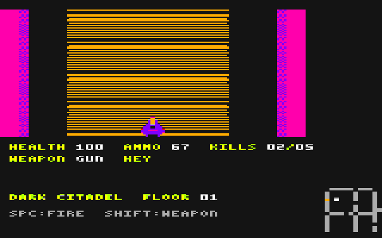
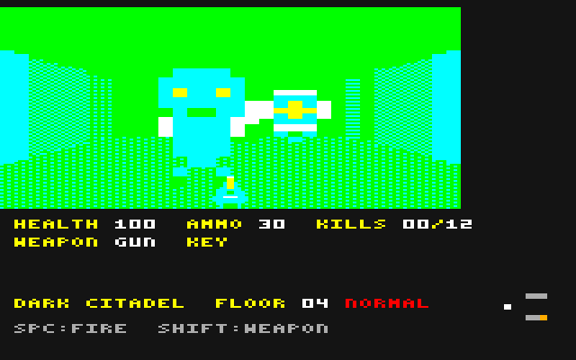
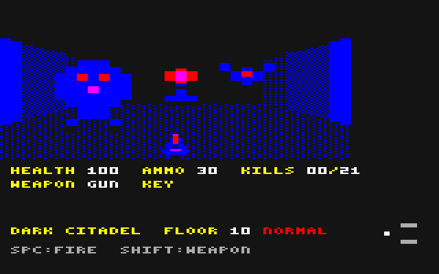
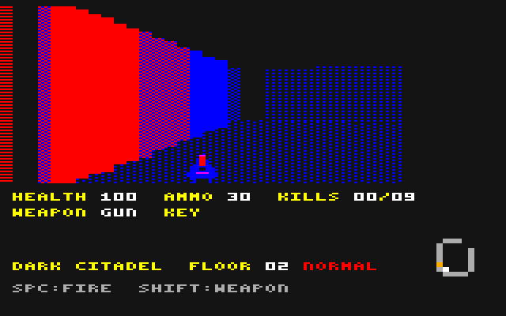
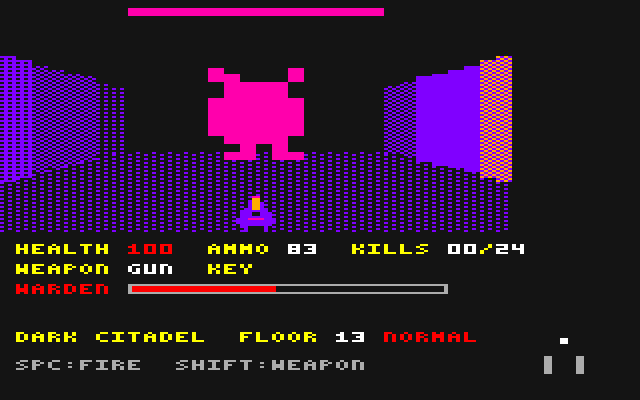
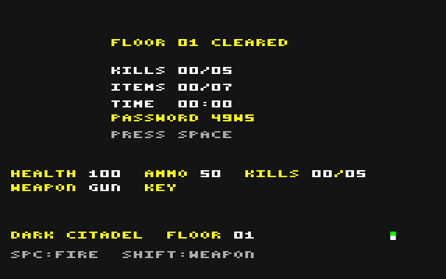
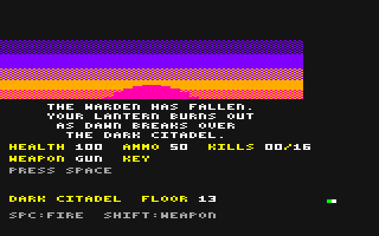
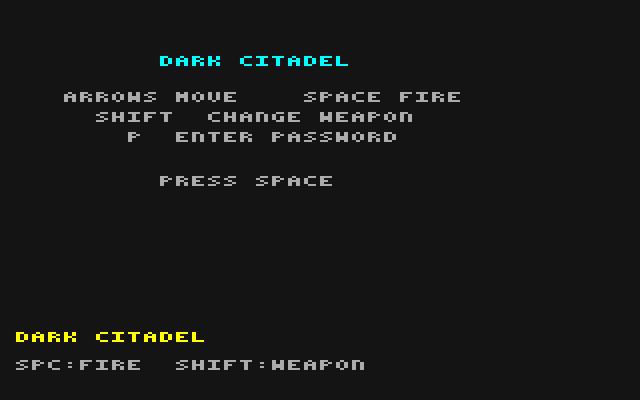

# DARK CITADEL

[English](README.md) | **日本語**

**PC-6001mkII用 オリジナル一人称迷宮シューティング**



*PC6001VWでの実際のプレイ（録画から切り出し、実際の速さ）*

ランタンの明かりだけを頼りに、闇に沈んだ城塞の13フロアを下から上へ抜けていく、一人称視点のシューティングです。
レイキャスティング方式で壁や敵を立体的に描き、敵は音声合成LSI（μPD7752）でうめき声や断末魔を上げます。
名前、ロゴ、マップ、キャラクター、配色、効果音、敵の声、曲はすべてこのプロジェクトのために新しく作ったものです。

| | |
|---|---|
|  |  |
| 敵は8種類。上の階ほど強い敵が混ざります | 膨れ虫、灯火の砲台、蝙蝠（10階） |
|  |  |
| 明かりは奥行き5マスまで。照らした壁が右下の地図に描かれていきます | 最上階では番人（ボス）が出口を守ります |
|  |  |
| フロアクリアの集計と、次のフロアのパスワード | エンディング：城塞に夜明けが訪れる |

## 特徴

- PC-6001mkII（mode 5、160×200ドット、16色）で動く、ダブルバッファのレイキャスティング
- 24×24マスの13フロア、鍵のかかった扉、オートマッピングの地図
- 銃と斧の2つの武器、8種類の敵（ボス含む）、回復・弾薬・鍵・ランタンの油
- 3段階の難易度（EASY／NORMAL／HARD）。上の難易度ほど敵が増え、受けるダメージが大きく、補給が減ります
- 敵の声は音声合成LSI、効果音とBGM（5曲）はPSG
- パスワードで途中のフロアから再開（記録も引き継ぐ）、隠しコマンドのデバッグモード
- タイトルのロゴ、エンディング（夜明けの場面と集計画面）

## ダウンロード

[Releases](../../releases) から次のファイルをダウンロードしてください。

| ファイル | 内容 |
|---|---|
| `fps.cas` | エミュレータ用のカセットイメージ（約19.4KB） |
| `fps.wav` | 実機用の音声データ（約3分26秒、48kHz・8bit・モノラル） |
| `vtest.cas` | 音声合成の確認用（数字キー1〜9、0、A、Bで敵の声、Pで効果音と声を同時に鳴らす） |

## 遊び方（PC6001VW）

1. 機種をPC-6001mkIIにして、LOAD-TAPEに `fps.cas` を設定する
2. 起動画面で `5`（N60m BASIC）を選び、`How Many Pages?` には `1` を入力する
3. `CLOAD` を実行し、`Ok` が出たら `RUN` を実行する
4. タイトル画面で ←→ で難易度を選び、SPACEを押すと始まる



### 実機で遊ぶ場合

1. `fps.wav` をPCで再生し、オーディオ出力をPC-6001mkIIのCMT入力（データレコーダー端子）につなぐ
   （またはカセットテープに録音してデータレコーダーで再生する）
2. mode 5で起動し、`CLOAD` を実行してからWAVを再生する
3. `Ok` が出たら `RUN` を実行する

- リモート端子のないつなぎ方では、BASIC部分のロード後もWAVが止まらずに先へ進みます。
  WAVにはBASIC部分の後に2秒のリーダー音を入れてありますが、間に合わない場合は `Ok` の時点で再生を一時停止し、`RUN` を入力してから再生を再開してください。
- 出力音量は大きめにしてください。
- **WAVは実機ではまだ試していません。** 波形を読み戻して元のデータと一致することは確認済みですが、機材によっては音量や極性の調整が必要になるかもしれません。
- 敵の声は、PC6001VWと同じ方式の音声合成の再現を元に作ったため、実機では音色が違う可能性があります。

## 操作

| キー | 動作 |
|---|---|
| ←→ | 旋回 |
| ↑↓ | 前進・後退 |
| SPACE | 射撃（弾が切れていると空撃ちの音）／斧を振る |
| SHIFT | 武器の持ち替え（銃⇔斧） |
| STOP | 一時停止（もう一度押すと再開） |
| P（タイトル画面） | パスワードの入力 |

ジョイスティックでも操作できます。

## ルール

- 各フロアのどこかにある、光る壁（出口）に触れるとフロアクリアです。13フロア目（最上階）を抜けるとエンディングです。
- 扉は体当たりで開きます。オレンジとバイオレットの扉は、同じ色の鍵を拾うまで開きません。鍵は必ずその扉の手前の部屋にあります。
- 敵は上の階ほど数が増え、強い敵が混ざります。どの敵も、壁や閉じた扉の向こうからは攻撃してきません。

| 敵 | 登場 | 体力（命中数） | 特徴 |
|---|---|---|---|
| 徘徊者 | 1階から | 3 | 歩いて近づき、爪で攻撃（8ダメージ） |
| 浮遊体 | 1階から | 4 | 距離を取り、光の弾を撃つ（5ダメージ） |
| 蝙蝠 | 3階から | 1 | 影走りよりも速く、左右に大きく振れながら飛ぶ（振れる向きを変える間合いが不規則）。体当たり（4ダメージ） |
| 重装兵 | 4階から | 8 | 遅いが硬い。ゆっくり振りかぶって強打（20ダメージ） |
| 膨れ虫 | 5階から | 6 | 気付くと転がるように素早く迫り、1マス以内で膨らんで、すぐに破裂する。周囲1.5マスに25ダメージ（見通せる位置にいれば）。撃って倒しても、その場で破裂する。破裂は他の敵も巻き込み（3ダメージ）、近くの膨れ虫は続けて破裂する |
| 影走り | 7階から | 2 | とても速く、左右にジグザグに動いて狙いにくい。素早い爪（5ダメージ） |
| 灯火の砲台 | 9階から | 10 | 動かない。8マス以内で見通せる位置に来ると、明かりの外の暗闇からでも気付き、すぐに撃ち始める。以後1.5秒ほどおきに光弾（8ダメージ） |
| 番人（ボス） | 13階のみ | 30 | 出口の部屋を守る。他の敵の1.5倍の大きさ。近くでは強打（15ダメージ）、離れると光弾（10ダメージ） |

- 13階の出口は、番人を倒すまで開きません。番人が動き出すと、メッセージ行に体力ゲージ（灰色の枠の中の赤い棒）が出ます。
  13階には専用の曲があり、番人の攻撃が届く範囲（番人から見通せる位置）にいる間だけボス戦の曲に変わります。
- 武器は2つです。今持っている武器は、2行目のWEAPON（GUN／AXE）に出ます。
  - 銃（GUN）：弾を1発使い、遠くの敵にも届きます（1ダメージ）。
  - 斧（AXE）：弾を使いません。届くのは約1.2マス先までですが、1振りで2ダメージ。
  - 最後の1発を撃つと自動で斧に持ち替えます。
- 拾える物：回復（体力が満タンのときは拾いません）、弾薬（1個で12発、最大99発）、鍵、ランタンの油（3階から各フロアに1つ。約1分間、明かりが7マス先まで届きます。その間、2行目にOILと出ます）。
- ランタン：明かりは奥行き5マスまでしか届かず、その先は闇です。闇の中の敵は見えず、撃つこともできません。
- 地図（右下）：ランタンの明かりが届いた壁と扉だけが描かれていきます。北が上で、自分（白い点）が常に中央にあり、地図の方が動きます。
- 体力が0になると、「CONTINUE」（そのフロアの最初から、体力満タンでやり直し）か「TITLE」を選べます。
  CONTINUEでは、弾薬が難易度ごとの数（下の「難易度」の表）に満たなければ、そこまで補充されます。
- 画面の表示（視界の下）：
  - 1行目：HEALTH（体力）、AMMO（弾数）、KILLS（撃破数／そのフロアの敵の数）
  - 2行目：WEAPON（今の武器）、KEY（持っている鍵）
  - 3行目：メッセージ（アイテム取得、鍵が必要な扉、番人の体力ゲージなど）
  - 4行目：DARK CITADEL、FLOOR（今いるフロア）、難易度
  - 5行目：操作の案内
  - 被弾すると体力の数字が赤くなり、攻撃してきた方向の画面の端が光ります。弾や斧が当たった敵は一瞬光ります。
- 記録：フロアクリア時に撃破数、アイテム数、クリアタイムを、エンディングでは合計時間、合計撃破数、やられた回数、ベストタイム（難易度ごと）を表示します。

## 難易度

タイトル画面で ←→ を押して選びます（EASY → NORMAL → HARD → EASY と一巡します。電源を入れたときは NORMAL）。選んだ難易度は、ゲーム中のフロア番号の右に赤字で表示されます。

| | EASY | NORMAL | HARD |
|---|---|---|---|
| 敵の数 | 各階の基本の数 | 1.5倍 | 2倍（番人は1体のまま） |
| 受けるダメージ | そのまま | 1.5倍 | 2倍 |
| 開始時の弾薬 | 50 | 30 | 0（斧で始まる） |
| 回復アイテム | そのまま | 半分 | 半分 |
| 弾薬アイテム | そのまま | 半分 | 半分（1個6発） |
| CONTINUE時の弾薬の補充 | 30＋3×（階数−1）発まで | 20＋2×（階数−1）発まで | なし |

- 増える敵は、その階の敵と同じ種類の組み合わせで、スタートの部屋の外に置かれます（配置はビルド時に決まり、毎回同じです）。
- 回復アイテムと弾薬アイテムの「半分」は、1つおきに置かれない形です。
- ベストタイムは難易度ごとに記録し、タイトル画面には選んでいる難易度のものを表示します。
- 難易度はパスワードにも含まれます。

## パスワード

- フロアをクリアすると、集計画面に次のフロアのパスワード（11文字）が出ます。体力、弾数、難易度と、それまでの記録（合計時間、合計撃破数、やられた回数）が含まれます。
- タイトル画面で `P` を押し、11文字を入力すると、そのフロアから始められます。記録も引き継がれるので、途中から再開してもエンディングには通しの記録が出ます。
- パスワードで再開したゲームも、ベストタイムに記録されます（デバッグモードのゲームは記録しません）。

## エンディング

13階の番人を倒して出口を抜けると、城塞に夜明けが訪れる場面と短い文章のあと、集計画面になります。演出の途中でSPACEを押すと飛ばせます。

## デバッグモード（テスト用）

タイトル画面で ↑ ↑ ↓ ↓ ← → ← → と入力すると、デバッグメニューが開きます。上下で項目を選び、左右で値を変えます。

| 項目 | 内容 |
|---|---|
| FLOOR | 開始フロア（1〜13） |
| SOUND | サウンドテスト。1〜7：効果音、8〜27：敵の声、28〜32：BGM。SPACEで鳴らす |
| INVINCIBLE | 無敵（被弾の音と赤い表示は出ますが、体力は減りません） |
| START | 選んだフロアから、弾薬99で開始 |
| EXIT | タイトル画面に戻る |

デバッグモードで遊んだ記録は、ベストタイムに残しません。

## ビルド

必要なもの：Python 3、[ZX Basic](https://github.com/boriel-basic/zxbasic) のアセンブラ `zxbasm`（`pip install zxbasic`）、Pillow（`pip install pillow`）。
テストには Z80 エミュレータのパッケージ（`pip install z80`）も使います。

```bash
python tools/fps_gen.py
python tools/build_fps.py
python tools/cas2wav.py fps.cas fps.wav
```

- `fps_gen.py`：表、絵、ロゴ、マップ、変数配置を生成します（`src/fps_*.inc`、フロアの見取り図 `build/floors_preview.png`）。
- `build_fps.py`：低位RAMに置くデータ（`src/fps_ram.asm`）を組み立てて圧縮し、本体と合わせて `fps.cas` と `vtest.cas` を作ります。
- `cas2wav.py`：`.cas` を実機用の `.wav` に変換します。

## テスト

`tools/harness.py` は、Z80とPC-6001mkIIの必要な部分（mode 5の画面、タイマーとキーの割り込み、PSG、音声合成LSI）を模した、画面なしの実行環境です。
テストはゲームをこの上で実際に動かし、メモリと画面を調べます（`python tools/<名前>.py`、ビルドの後に実行）。

| テスト | 内容 |
|---|---|
| `fps_mech_test` | 扉、鍵、アイテム、出口、全フロアの遷移、時間の記録 |
| `fps_map_test` | 地図とオートマッピング |
| `fps_ray_test` | 全列の視線の結果を正確な計算と照合 |
| `fps_los_test` | 壁や扉越しに攻撃されないこと |
| `fps_enemy_test` | 敵の種類ごとの登場階、体力、攻撃力、速さ、動き、声 |
| `fps_foes_test` | 蝙蝠・膨れ虫・灯火の砲台（登場階、膨らみと破裂、撃って倒したときの破裂、巻き込みと連鎖、暗闇からの砲撃、蝙蝠の速さと振れ幅） |
| `fps_boss_test` | 番人の配置、出口の封鎖、目覚め、攻撃、体力表示、曲の切り替え、撃破 |
| `fps_axe_test` | 斧（持ち替え、届く距離、ダメージ、弾切れ時の自動持ち替え） |
| `fps_items_test` | ランタンの油、命中時の点滅、攻撃方向の表示、一時停止 |
| `fps_death_test` | やられたときのCONTINUE／TITLEの選択と弾薬の補充 |
| `fps_password_test` | パスワードの表示・入力・誤り（難易度と記録の引き継ぎを含む） |
| `fps_diff_test` | 難易度の選択、敵の数、受けるダメージ、開始時とCONTINUE時の弾薬、回復・弾薬アイテム、難易度ごとのベストタイム |
| `fps_ending_test` | エンディング |
| `fps_debug_test` | 隠しコマンド、フロア選択、サウンドテスト、無敵、EXIT |
| `fps_sfx_test` / `fps_voice_test` | 効果音のチャンネルと遅延、BGM、音声合成への送信 |
| `fps_tables_test` | 起動時に作る表 |
| `fps_still_test` | 立ち止まっている間の部分的な描き直しが、全部描き直したときと1バイトも違わないこと |
| `fps_ab_test` | 2つのビルドで同じ操作をして、画面がフレームごとに同じか比べる（最適化の確認） |
| `fps_test` / `fps_prof` | 速度の計測と、処理時間の内訳 |
| `fps_shots` | このREADMEのスクリーンショット（`docs/images`、アニメーションGIFを除く）を作る |

## 技術メモ

- 画面：mode 5（160×200ドット、16色）、8000h／C000hのダブルバッファ。視界は32列×4ドット×112行です。
  視界はプレーン1をフロアごとに一定にしてプレーン0だけを描き、天井と床は前回の壁の上端・下端との差分だけを塗り直します。
- ローダー：BASICが小さなマシン語を書き込み、BASIC ROMのテープルーチンで本体を4000hに読み込みます。読み込み後はROMの位置をRAMに切り替えて起動します。
- 割り込み：IM2。2msのタイマー割り込みでフレームの間隔を測り、効果音とBGMを進め、音声合成LSIにデータを送ります。描画は最大25フレーム/秒です。
- レイキャスティング：DDAをレジスタで回し、掛け算は4分の1平方の表、壁の高さは表引きで、割り算を使いません。視線は奥行き5マスで打ち切ります。
- フロア：24×24マス。ビルド時に `tools/fps_levels.py` が部屋を分割して作り（1フロア7〜18部屋、部屋は木の形に扉でつながる）、固定の乱数の種で毎回同じ配置になります。
- 敵の声：音声合成LSIの外部パラメータ方式で、10msごとの7バイトのフレームを送ります。声のデータは `tools/voices.py` で作り、`tools/d7752sim.py` で試聴できます。
- BGM：`tools/music.py`。16msごとに音符と音量の変化を進めます。
- タイトルのロゴ：夜空に城塞の塔が影絵で並び、手前に題字を置いたデザインです。`tools/fps_logo.py` でドット単位に描き、プレーンごとにLZ圧縮してプログラムに持ち（約1.1KB）、タイトル画面を描くたびに画面へ直接展開します。
- 容量の節約：
  - 起動時にだけ使うデータ（低位RAMに置くデータと絵の圧縮データ、表の元になる値）はプログラムの最後に置き、8000h以降（ローダーのBASICの領域）にはみ出してもよいようにしています。展開してから画面を消去するので、ゲーム中に使う部分が4000h〜7FFFhに収まっていれば足ります。
  - 三角関数の表は1/4周期分だけを持ち、壁の高さの表などは起動時に作ります。
  - キャラクターの絵は4ビット単位に詰めてLZ圧縮し、起動時に展開します。
  - マップは「壁の線分」と「鍵の扉・出口のマス」として持ちます（`tools/fps_mapcode.py`。13フロアで約1.4KB）。展開せずに読める形なので、プログラムに置いています。
  - 武器の絵、難易度で増える敵の配置、敵の声、BGMは低位RAMに置く形で別に組み立ててLZ圧縮し（`tools/lz.py`）、起動時に展開します。
- 高速化（工夫の前より1フレームの処理が約半分）：
  - 立ち止まっている間は視界を計算し直さず、敵や武器が重なった列だけを描き直します。
  - 列ごと・画面ごとに前回の壁の色合いを覚えておき、同じなら壁が伸びた分の行だけを描きます。
  - 掛け算は上位バイトが小さいときは足し算で済ませ、よく通る場所では呼び出しをせずにその場に展開しています。
  - 壁の継ぎ目の判定は、視線の途中の値と角度ごとの基準値の表を比べて、掛け算なしで決めます。
  - 明かりの外や背後の敵は、奥行きだけを求めて残りの計算を省きます。
  - 地図の描き直しは、2マス分の色から画面のバイトを直接引く表で行います。
- ソース：
  - `src/fps.asm`：描画エンジン、入力、音声合成
  - `src/fps_game.asm`：敵、射撃、扉、アイテム、フロア、地図、画面、効果音、BGM
  - `src/fps_ram.asm`：低位RAMに置くデータ（生成されたものを取り込む）
  - `src/vtest.asm`：音声合成の確認用ビルド
  - `tools/fps_logo.py`：タイトルのロゴ（`python tools/fps_logo.py` で `build/logo.png` に書き出して確認できる）

## ライセンス

[MIT License](LICENSE)
